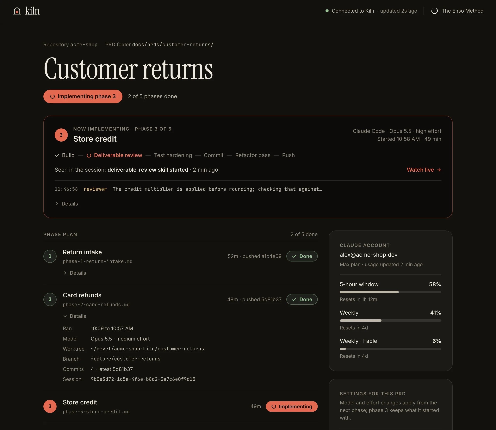

# Kiln

**Plan it together. Then walk away.**

Kiln builds a PRD you already planned with the [Enso Method](https://github.com/EnsoDynamics/enso-method), one phase after another, with nobody sitting in the loop. Every phase gets a fresh Claude Code or Codex session. Git confirms the phase landed before the next one starts. When the last phase closes, delivery and test audits check the whole PRD, and the work waits for you as pull requests.

You come back when it's done, or when a phase genuinely needs you.

[ensomethod.org/kiln](https://ensomethod.org/kiln/) · [Install](#install) · [Quick start](#quick-start) · [Update](#update) · [How it works](#how-it-works)



## Why Kiln

The Enso Method puts the hard thinking first. A PRD in business language, a technical design checked against the real code, open questions answered or written down as assumptions, and a plan cut into phases small enough for one AI session each. That half deserves your attention.

The other half used to need a babysitter. Start a session for phase 1, wait, start a fresh one for phase 2, wait, then run the delivery and test audits and act on what they find. A dozen phases meant a dozen interruptions across a day, and none of it ran overnight. Kiln runs that loop for you.

Kiln is optional. Everything it does, a person can do by hand with the same skills. It never edits the skills, and nothing in your repository depends on it.

## Requirements

| | |
| --- | --- |
| Node.js | 22.15 or later |
| Git | 2.29 or later |
| [GitHub CLI](https://cli.github.com/) | Signed in to github.com (`gh auth login`). The repository's `origin` must be on GitHub. |
| An agent | [Claude Code](https://docs.claude.com/en/docs/claude-code) 2.1.311 or later, signed in, or Codex 0.162.1 or later, signed in through ChatGPT |
| PowerShell | 7.5.2 or later, for Codex on Windows only |
| [Enso Method](https://github.com/EnsoDynamics/enso-method#get-started) skills | Installed in that agent |
| Platform | macOS is validated. Linux and Windows are best effort; please [open an issue](https://github.com/EnsoDynamics/kiln/issues) if something breaks. |

Kiln accepts every version at or above these minimums and checks them before it starts work. If a newer Claude Code or Codex changes what **Message Claude**, **Pause & take over** or Codex command evidence relies on, that feature turns off with a compatibility notice in the browser view and `kiln status`, and the rest of the run carries on. Billing details Kiln doesn't recognise show the neutral **Claude Code settings** summary instead ([Billing](#billing)). Codex details and limits are in [Codex prerequisites and validation limits](docs/release/kiln-codex-macos-validation.md).

## Install

```sh
npm install -g @ensodynamics/kiln
```

This installs the `kiln` command along with its browser view. Check it worked:

```sh
kiln --help
```

If you don't have the Enso Method skills yet, install them in your agent too:

```sh
# Claude Code
claude plugin marketplace add EnsoDynamics/enso-method
claude plugin install enso-method@enso-method

# Codex
codex plugin marketplace add EnsoDynamics/enso-method
codex plugin add enso-method@enso-method
```

## Quick start

Kiln starts where planning ends. You need a PRD that has been written, refined, given a technical design and split into phases with the Enso Method skills ([how that works](https://github.com/EnsoDynamics/enso-method#get-started)). Commit those documents, then from the repository root run:

```sh
kiln run docs/prds/<name>
```

The path is the PRD's directory (`docs/prds/<name>/` or `docs/changes/<name>/`) or the PRD file in it.

1. **Review.** Kiln checks the documents and opens its browser view on what it found, with the phase documents, the base branch and the feature branch it will use. Nothing runs yet.
2. **Start.** Confirm the PRD has been refined, choose the agent, model and effort, and press **Start**.
3. **Walk away.** Kiln runs one session per phase in the feature's own worktree and checks in Git that each phase landed. Keep the terminal open. Ctrl+C interrupts the current session, and `kiln run` again picks up where it stopped.
4. **Come back to pull requests.** When every phase is done and the whole PRD has passed its delivery and test audits, the feature branch is pushed with its pull request waiting for your review.

## When a phase needs you

When a phase doesn't land, the **Needs you** screen shows the session's last message word for word and each check that failed, with the fact behind it. Then you choose.

- **Reply** in the browser. Kiln sends it to that same session, with its full history, and carries on.
- **Open the session yourself.** Copy the command Kiln shows to continue that exact conversation in your terminal. When you're done, exit it and press Resume in Kiln. You won't need to repeat your answer.
- **Finished it by hand?** Use **Verify Phase … & advance**. Kiln runs the same checks and moves on only if they pass.

A Resume that finds the phase already complete asks before advancing and keeps any reply you hadn't sent.

## Update

Stop any running Kiln first. Kiln reads its prompts and hooks from the installed package while it works, so replacing the package underneath a live run can mix two versions. List what's running with

```sh
kiln status
```

then press Ctrl+C in each Kiln terminal. To avoid interrupting a phase, use **Pause after this phase** and stop Kiln once the phase finishes. Then update:

```sh
npm install -g @ensodynamics/kiln@latest
```

Run `kiln run <PRD-path>` again for each unfinished PRD. Its saved progress carries forward automatically, and Kiln opens the phase overview so you can review it before pressing **Resume Kiln**.

To see which version you have and whether a newer one exists:

```sh
npm ls -g @ensodynamics/kiln
npm outdated -g @ensodynamics/kiln
```

Saved runs move forward only. Once a newer Kiln has opened a run, an older Kiln refuses to read it and asks you to update, so don't downgrade in the middle of a PRD. Never delete saved state to get around that message.

Keep the Enso Method skills current too, since Kiln's sessions run whatever version you have installed:

```sh
# Claude Code, then restart it
claude plugin marketplace update enso-method
claude plugin update enso-method@enso-method

# Codex
codex plugin marketplace upgrade enso-method
```

Release notes for each version are on the [GitHub Releases](https://github.com/EnsoDynamics/kiln/releases) page.

## Uninstall

```sh
npm uninstall -g @ensodynamics/kiln
```

That removes the command. Two things stay behind on purpose.

- **Saved run history** lives in `~/.local/state/kiln` (or `$XDG_STATE_HOME/kiln`) on macOS and Linux, and `%LOCALAPPDATA%\kiln` on Windows. Delete that folder if you no longer need it.
- **Worktrees and branches** Kiln created for your PRDs stay in your repositories, with your work in them. The default worktree location is a `.worktrees` folder beside your checkout. Remove them with `git worktree remove` once their pull requests are merged.

## How it works

Each phase runs the same way.

1. **A fresh session.** Kiln starts a new agent session in the feature's worktree, pointed at the next phase document. It says only what you would have typed yourself.
2. **The skills do the work.** Build, deliverable review, test hardening, commit, refactor pass and push, all by the Enso Method skills exactly as published.
3. **Git says if it's done.** The phase document is closed, everything is committed and the branch matches origin. All three pass or the phase isn't done, whatever the session said about itself.
4. **Then the next one.** Kiln rereads the plan and starts the next phase. When the last one closes, delivery and test audits check the whole PRD, and any repairs they require get another audit cycle before Kiln finishes.

A few things worth knowing:

- **Interruptions.** Ctrl+C, a closed terminal, a restart or a laptop that slept. Running `kiln run` again checks the saved work and opens the phase overview without starting model work. Review it, then press **Resume Kiln**.
- **Usage limits.** When a session hits your plan's limit, Kiln waits for usage to come back and resumes that same session.
- **Background work.** If a subprocess, test run or reviewer is still needed, the session waits for it and carries on. A progress message saying "waiting" does not mean Kiln needs you. The [subprocess completion validation](docs/design/kiln-required-subprocess-completion-validation.md) describes the checks and their limits.
- **Plans that grow.** Phases appended or split in the assigned worktree join the remaining plan once the current activity passes its checks, with a notice. Changes made in your original checkout or on other branches don't affect a running PRD until you deliberately integrate them into its worktree.
- **Several repositories.** When a PRD spans repositories, each gets its own worktree, feature branch and pull request.
- **Pause.** **Pause after this phase** lets the current phase finish, commit and push, then starts nothing new until you press Start.
- **Watch live.** Follow each tool call and message as it happens, with the session's model, effort and commits, and your account's usage beside it.
- **Message or take over.** On macOS with Claude Code 2.1.311 or later, **Message Claude** sends the running session a note it reads at its next opportunity, and **Pause & take over** stops it at the next safe point so you can carry on in that conversation yourself. Kiln asks Claude Code to take each message as plain text but can't guarantee how every version handles it. If Kiln stops recognising what a newer Claude Code sends back, that control turns off with a compatibility notice and the phase carries on.

Completion checks use the assigned worktrees' Git state and the audit and delivery receipts. Other checkouts and worktrees can change normally while Kiln runs.

### What Kiln may do with your code

By default Kiln commits and pushes only to feature branches and leaves pull requests for your review. Before Start or at Needs you, **Allow early merges** lets you approve a named repository and base branch for this run. Kiln may then merge there early when a PRD criterion needs deployment or verification, and the repository's existing CI/CD controls the deployment. Required checks and reviews still apply, and remaining work still ends in a review pull request. Other branches, separate release workflows and destructive actions stay unauthorized.

### Billing in brief

Before every model run, Kiln shows how the next session will be billed, either your Claude subscription or ChatGPT account with its email and plan, or a detected API key or alternate provider. API billing needs your explicit approval for that PRD before any work starts. Kiln never changes your provider settings or spending limits, and it is not a spending cap. [Billing](#billing) below has the details for Claude and Codex.

### Driving Kiln from the terminal or a bot

The browser view is the main interface, but every control for existing work is also a command, so a script or a bot on the same machine can report progress and answer stops. Start with `kiln status --json` and `kiln <command> --help`. [Kiln command line and bot control](docs/kiln-command-line-and-bot-control.md) covers command IDs, status tokens, live messages and takeover.

## Writing requirements for Kiln

Kiln's audits snapshot the PRD, design, assumptions, phases and every local Markdown link in them, recursively. Links can reach other requirements directories and roadmap contracts. A missing required target stops the audit and reports the document chain.

For a link that is background only (provenance or history, not requirements or required evidence), give it the exact title `kiln:reference` and Kiln won't follow it.

```markdown
[Original handoff](../../../source-material/handoff/index.md "kiln:reference")
```

Governing documents and explicit `Superseded by:` / `Replaces:` pointers stay mandatory even when a reference-only link also points at them. Existing files still count in repository fingerprints, reports must still supply all required evidence, and no directory is excluded automatically.

## Billing

Before every model run, Kiln shows how the next session will be billed and blocks separately charged access until you approve it. The details differ by agent.

### Claude

Before Start or Resume, Kiln shows billing for the next Claude run. A confirmed subscription says **Claude subscription**, with the account email directly below it. Billing follows your Claude account settings. If Claude reports that paid overflow is enabled for that same account, Kiln shows a factual notice and links to [Claude usage settings](https://claude.ai/settings/usage); it does not ask for another approval or change your spending limits. Missing overflow details do not mean paid usage is disabled.

An API key, authentication helper, alternate endpoint or provider setting can select access charged separately from a subscription. Kiln shows the detected source and requires **Use API billing for this PRD** (or the named/configured provider) before model work. The unticked choice authorizes only this PRD execution, including later phases and restarts, while its detectable billing context stays the same. Approval and Recheck billing never start or resume work. You can clear approval while no AI session or dispatch is running. A changed provider, credential source, known payer or detectable credential requires approval again; switching away invalidates the old choice.

If you intended subscription use, change the displayed override at its source and recheck. For an inherited environment variable, stop Kiln and restart it from the corrected environment. Kiln never deletes credentials, edits provider settings or silently chooses a different route. A sign-in failure still needs `claude auth login`, followed by recheck; billing approval cannot bypass readiness or add provider support.

When authentication works but additional billing details cannot be established and no override is detected, the neutral **Claude Code settings** summary lets work continue. Unavailable details are not a subscription guarantee. Running screens retain the billing recorded at launch; different fresh readings apply to the next run. Disconnected screens show last-known information with no approval or launch controls.

These checks run before each model-consuming launch or resume, including recovery, audits and final delivery. They inspect settings without making a model request and preserve local completion checks. They detect observable overrides; they are not a per-request billing firewall or a spending cap. A running CLI may reread settings or rotate credentials, and a helper can rotate its secret without Kiln observing it. Kiln does not interrupt an active session over a later settings change and makes no zero-cost guarantee. Set spending limits with [Anthropic](https://console.anthropic.com/settings/limits), [Claude](https://claude.ai/settings/usage), or the configured provider.

### Codex

Kiln shows **ChatGPT account**, the reported account email and plan, and “Billing follows your ChatGPT account settings.” Check your [ChatGPT usage and spending settings](https://chatgpt.com/codex/settings/usage). ChatGPT sign-in does not guarantee included-only or zero-extra-cost usage: eligible work may use account or workspace credits under those settings.

When Codex reports attributable workspace credits, Kiln shows each reported bucket separately, as a balance or availability fact. A balance is not a dollar amount or proof that paid usage or auto-reload is enabled, and it does not mean this run is using credits. Missing, stale or unattributable optional credits add no warning or confirmation and do not prevent Start or Resume. Existing usage gauges and Codex's recovery permission, credit and administrative restrictions still apply. Kiln never buys credits, changes spending preferences or redeems usage resets.

Running screens retain the account and credit facts recorded at launch; a different fresh reading is labelled for the next run. Older runs with no saved billing remain unavailable. Disconnected views mark their information last known and disable launch, resume and refresh controls. The launch-time checks and no-spending-cap boundary above apply to Codex too.

Codex requires ChatGPT sign-in and the OpenAI provider before every launch and resume, including after restart. API-key-only or missing authentication requires `codex login`, then refresh Codex information. A different provider requires changing the provider in Codex settings and refreshing; Kiln never rewrites it. Required authentication/configuration errors remain blockers. Claude billing approval never authorizes Codex API-key access.

## Troubleshooting

`kiln run` prints every problem it finds before starting. The common ones:

| Message | Fix |
| --- | --- |
| `gh isn't signed in to github.com` | `gh auth login`, then run the same command again |
| `The checkout … has uncommitted changes` | Commit or stash them. Kiln starts from a clean checkout. |
| `The checkout has no origin remote` or origin isn't on GitHub | Kiln pushes branches and opens pull requests on GitHub, so `origin` must point there |
| This PRD already has a running Kiln | Use the browser address it prints, or `kiln status` |
| Port unavailable | Kiln uses ports 4700 to 4799. Free the reported port or stop a Kiln you no longer need. |
| Written by a newer Kiln | [Update Kiln](#update) |
| Claude or Codex sign-in fails | `claude auth login` or `codex login`, then press Recheck in the browser |

For anything else, `kiln status <PRD-path>` shows the full state of a run, and issues are welcome on [GitHub](https://github.com/EnsoDynamics/kiln/issues).

## Contributing

Issues, feedback and forks are welcome; pull requests generally aren't accepted. [CONTRIBUTING](CONTRIBUTING.md) explains why, and [SECURITY](SECURITY.md) says how to report a vulnerability privately.

## Documentation

- [Kiln v1 PRD](docs/prds/kiln-v1/kiln-v1-prd.md), what v1 delivers and its acceptance criteria. Later changes are in [docs/changes](docs/changes/) and [docs/prds](docs/prds/).
- [Architecture proposal](docs/design/kiln-architecture-proposal.md), with principles, the done check and the stop path.
- [Interface scenarios](docs/design/kiln-interface-scenarios.md) and the [mockups](docs/design/mockups/), the design of record for the screens.
- [Kiln roadmap](docs/kiln-roadmap.md) and the [future feature index](docs/design/kiln-after-v1-ideas.md).

Kiln was built with the Enso Method, so its own requirements, designs and phase plans in `docs/` are a working example of the method.

## Development

Requires Node.js 22.15 or later and Git 2.29 or later.

```sh
npm install
npm run verify
```

`verify` runs the dependency audit, lint, typecheck, unit tests, and the integration tests, which build `dist/` first and run real `git` against temporary repositories. `npm run test:package` packs Kiln, installs the archive globally into a temporary folder and runs that `kiln`.

To try a local build installed the way npm installs it (its `kiln --version` adds `(dev build, <when built>)`):

```sh
npm ci
npm pack
npm install -g ./ensodynamics-kiln-*.tgz
```

Development CI runs audit, lint, types, unit and contract tests, build and pack on Ubuntu. Release candidates also require full macOS verification with installation of the exact candidate archive, plus Windows build and pack. Run `npm run hooks:install` in the shared checkout for the local version gate, and `npm run release:prepare` before a release merge. Approved releases on `main` publish the checked archive to npm and attach it to a GitHub Release, as described in [Kiln npm release setup and operation](docs/release/kiln-npm-release-steps.md).

`npm run test:live-proof` is the authenticated live control tier. It runs on macOS with Claude Code 2.1.311 or later and a signed-in account, and fails when those are unavailable. Under `npm run`, `claude` resolves to the development dependency pinned at the minimum, so set `KILN_LIVE_PROOF_CLAUDE=<path>` to prove another installed Claude Code. It creates disposable conversations and local Git repositories to check live input, fresh turn context, checkpoint yield and terminal hand-back. The first run on a Claude Code version records its message and hook contract fixtures in `test/fixtures/live-control/`. It spends model usage and runs separately from credential-free CI. The normal offline integration suite checks the packaged hook, real process ownership and every recorded message and hook contract without a fresh model run.

## License

Kiln is [MIT licensed](LICENSE), copyright Enso Dynamics. Bundled browser libraries and fonts keep their own licenses. Their texts are in [Kiln third-party notices](view/public/kiln-third-party-notices.txt), also shipped as `dist/view/kiln-third-party-notices.txt` in the npm package.
